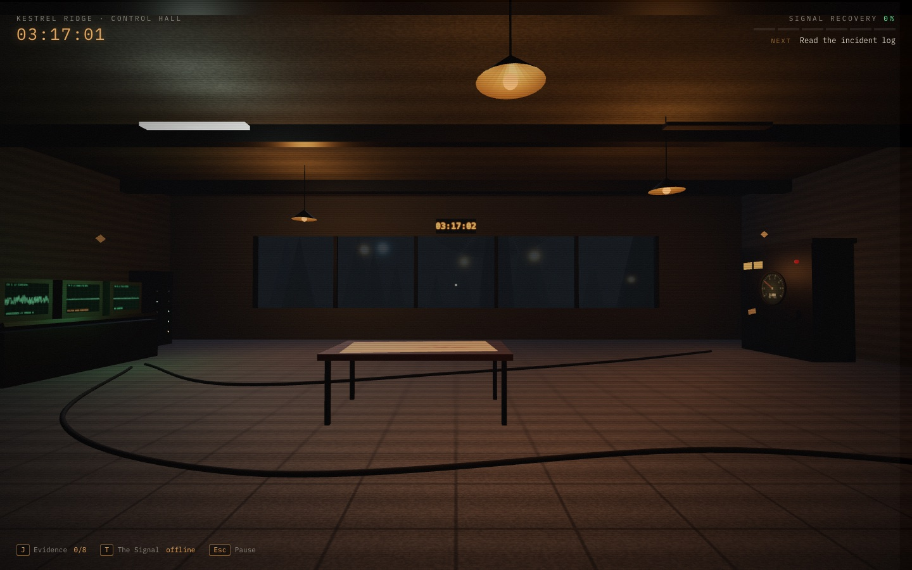
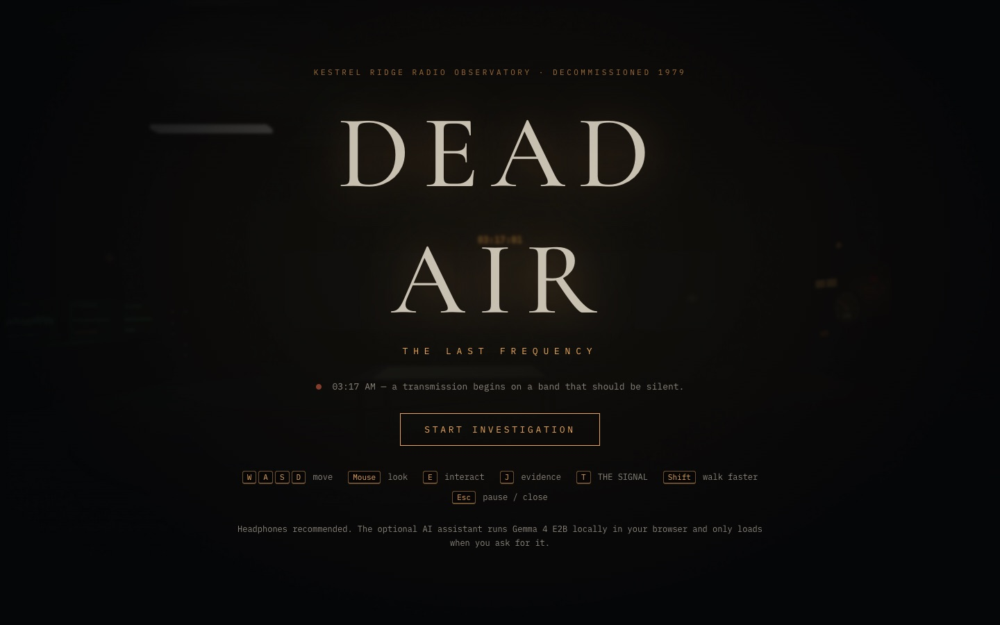
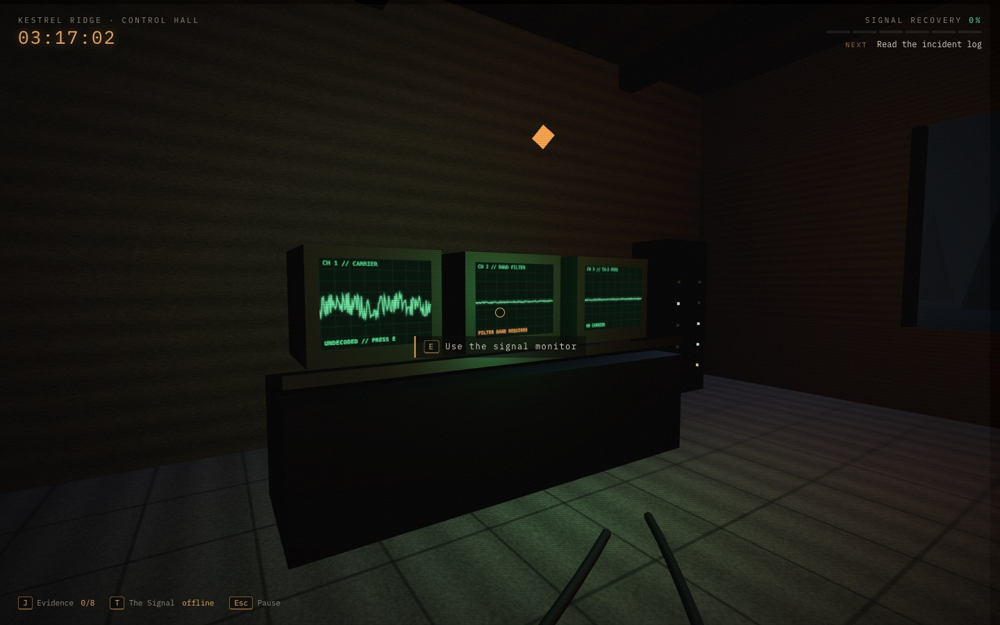
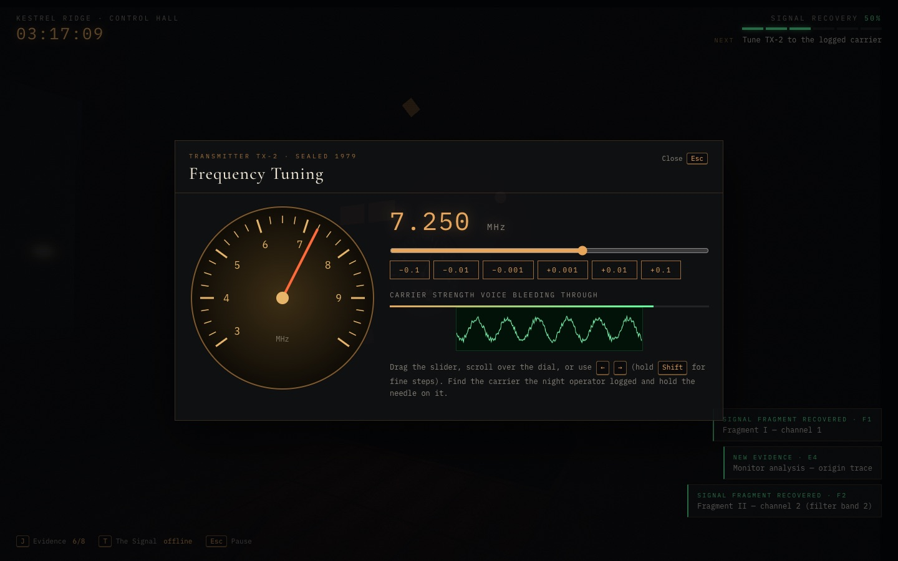
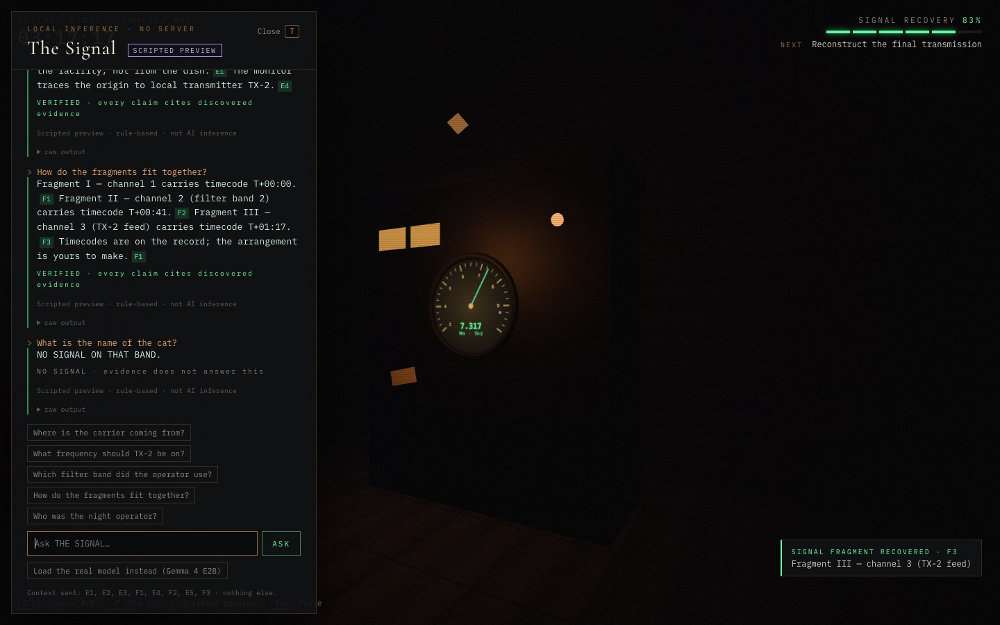
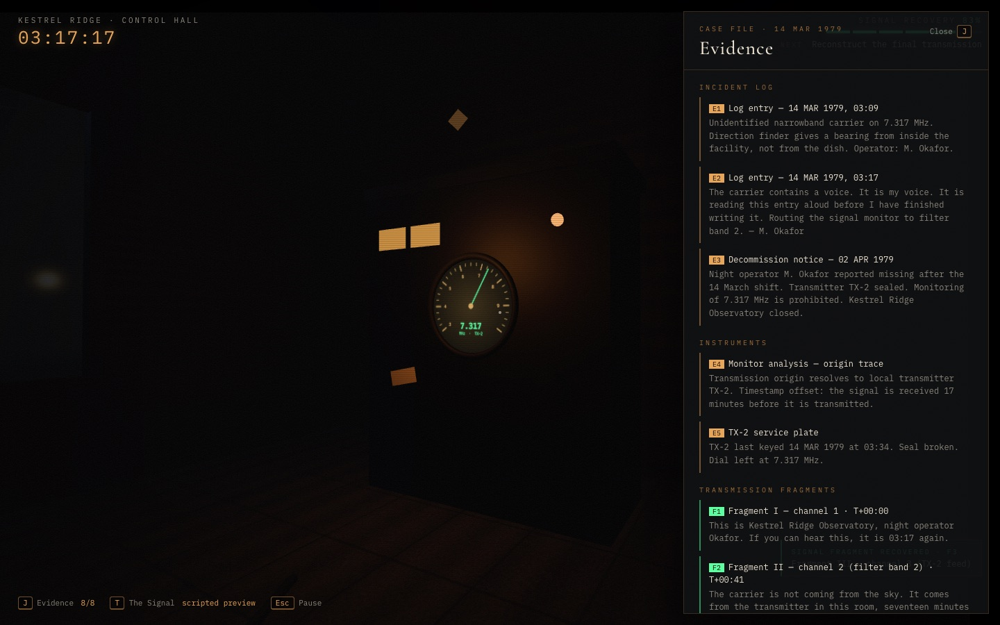
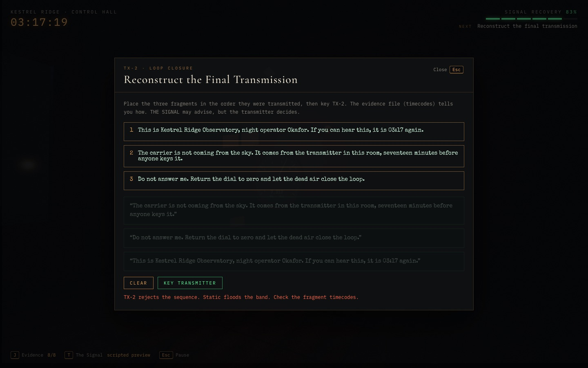
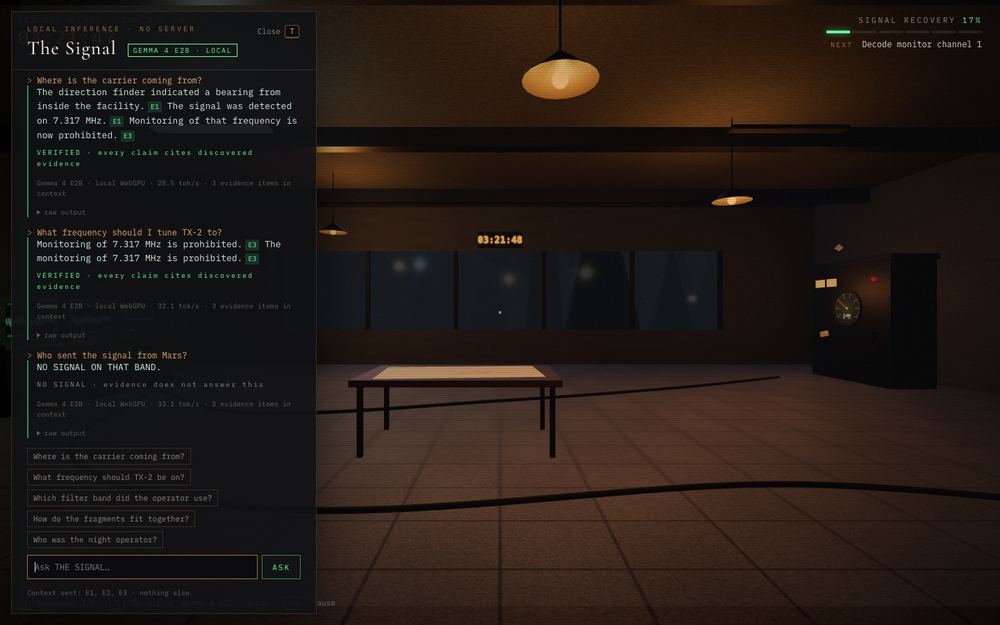

# DEAD AIR — The Last Frequency

A first-person 3D mystery set in an abandoned radio observatory, with an optional AI assistant that runs **entirely in your browser** on open weights (Gemma 4 E2B via Transformers.js + WebGPU).

> **03:17 AM.** Kestrel Ridge Radio Observatory has been sealed since 1979. Tonight a transmission begins on a frequency that is supposed to be dead. Explore the control hall, recover three signal fragments, tune transmitter TX-2 and reconstruct the final transmission.

Built for Hacktoberfest 2026, Week 4. Vite + TypeScript + Three.js. No backend, no API keys, no paid services.



| | |
|---|---|
|  |  |
|  |  |
|  |  |

---

## Quick start

Requires Node.js 20+ (developed on Node 25).

```bash
npm install
npm run dev        # http://localhost:5173
```

Production build:

```bash
npm run build      # type-checks with tsc, then bundles into dist/
npm run preview    # serves dist/ on http://localhost:4173
```

`dist/` is a static site. Any static host works (GitHub Pages, Netlify and so on). It has to be served over **https** or from **localhost** because WebGPU needs a secure context.

## Controls

| Key | Action |
|---|---|
| `W` `A` `S` `D` / arrows | Move |
| Mouse | Look (click the scene to capture the pointer) |
| `Shift` | Walk faster |
| `E` | Interact with the highlighted station |
| `J` | Evidence file |
| `T` | THE SIGNAL (AI assistant) |
| `Esc` | Close panel / pause |

Inside the transmitter panel, use `←` `→` to tune (hold `Shift` for 0.001 MHz steps). You can also scroll over the dial or drag the slider.

## What's in the game

Three interactive stations in a procedurally built control hall:

1. **Incident log** (desk with the amber lamp): the 1979 night-shift log and the decommission notice. These are historical evidence E1–E3.
2. **Signal monitor** (green CRT bank): three channels. Channel 1 can be demodulated straight away. Channel 2 needs the filter band named in the log. Channel 3 only carries a signal once TX-2 is transmitting. These give fragments F1–F3, plus the origin trace E4.
3. **Radio transmitter TX-2** (amber cabinet): the frequency-tuning puzzle. Static, a carrier tone, a scope trace and a strength meter all respond as you get closer. Hold the needle on the logged carrier to lock it (E5). Once all three fragments are recovered, TX-2 is also where you **reconstruct the final transmission**.

The HUD shows a six-step **signal recovery** progress bar and the next objective. The **evidence file** (`J`) lists everything you've recovered, with IDs.

<details>
<summary>Walkthrough (spoilers)</summary>

1. Read the incident log. It tells you the carrier is **7.317 MHz** and that the operator used **filter band 2**.
2. Signal monitor → CH1 → *Demodulate* (F1, E4).
3. Signal monitor → CH2 → *Band 2* (F2).
4. TX-2 → tune to 7.317 and hold for 1.5 s (E5).
5. Signal monitor → CH3 → *Capture* (F3).
6. TX-2 (or the evidence file) → *Reconstruct*: order the fragments by timecode, T+00:00 → T+00:41 → T+01:17, then key the transmitter.

</details>

---

## Architecture

```
index.html              title screen, HUD, modal and drawer shells
src/
  main.ts               game flow: pointer lock, overlays, stations, puzzles, reconstruction, ending
  world.ts              Three.js scene: procedural observatory, lights, fog, CRT/dial canvas textures,
                        first-person movement with AABB collision, interaction raycast
  story.ts              canonical story data: evidence E1–E5, fragments F1–F3, tuning target,
                        deterministic reconstruction rule
  state.ts              discovered evidence, completed steps, progress
  audio.ts              procedural WebAudio: mains hum, radio static, carrier tone (no audio files)
  signalPanel.ts        THE SIGNAL drawer UI: load flow, progress, chat, per-sentence verdicts
  signal/
    signal.ts           WebGPU check, prompt builder, evidence validator, scripted preview, worker client
    ai.worker.ts        Transformers.js + Gemma 4 E2B in a Web Worker (keeps the 3D loop smooth)
  style.css             charcoal / amber / radio-green HUD
```

- **Everything is procedural.** The room, racks, CRTs, the parabolic dish (a `LatheGeometry`), the pines, the textures (canvas noise) and the audio. There are no downloaded 3D, image or sound assets.
- **The game logic is fully deterministic and does not depend on the AI.** Puzzle gates live in `main.ts`. The win condition is `isCorrectOrder()` in `story.ts`: ascending transmission offset. The LLM can't unlock, skip or decide anything.

```
 player actions ──► state.discover(ids) ──► HUD / evidence file
                                   │
                                   ▼ discovered evidence only
 question ──► buildMessages() ──► ai.worker (Gemma 4 E2B, WebGPU) ──► raw text
                                                                       │
                                     validate(raw, discovered) ◄───────┘
                                       │ per-sentence: cited? cited item discovered?
                                       │ numbers & proper nouns present in evidence?
                                       ▼
                         VERIFIED / PARTIAL (struck-through claims) / REJECTED / NO SIGNAL
```

## The open-source AI: THE SIGNAL

| | |
|---|---|
| Model | **Gemma 4 E2B instruction-tuned** by Google DeepMind ([`onnx-community/gemma-4-E2B-it-ONNX`](https://huggingface.co/onnx-community/gemma-4-E2B-it-ONNX)), Apache 2.0 |
| Runtime | [Transformers.js](https://github.com/huggingface/transformers.js) `@huggingface/transformers` 4.3, ONNX Runtime Web, **WebGPU** backend |
| Precision | `q4f16` when the GPU supports `shader-f16`, otherwise `q4` |
| Download | ~3.4 GB on first use (text-only path), then served from the browser cache |
| Where it runs | A dedicated Web Worker in your tab. Questions and evidence never leave the machine. |

**How it loads.** Nothing is fetched until you open THE SIGNAL (`T`) and press *Load Gemma 4 E2B*. The worker loads the model with `Gemma4ForCausalLM`, which in Transformers.js runs Gemma 4 in **text-only mode**: just `embed_tokens` and `decoder_model_merged`. That skips the vision and audio encoders, which this game doesn't need. The panel shows byte-level download progress, the file currently being fetched, a shader warm-up step, and then generation status with tokens/sec. If loading or inference fails, the actual error message is shown.

**Grounding contract.** The model only sees what the player has recovered:

1. The system prompt contains **only discovered evidence**, each item tagged with its ID (`[E1]`, `[F2]`…). Undiscovered evidence is never sent. The panel footer lists exactly which IDs went into the context.
2. The model is told to end every sentence with the evidence IDs it relies on, to use no outside facts, and to answer `NO SIGNAL ON THAT BAND.` when the evidence doesn't cover the question. It's also told not to declare the final fragment order.
3. Every reply goes through `validate()` (`src/signal/signal.ts`) before it's displayed. A sentence is **removed and struck through, with the reason shown**, if:
   - it has no evidence reference,
   - it cites an ID that doesn't exist or hasn't been discovered,
   - it contains a number (year, time, frequency) that isn't in the evidence it cites, or
   - it uses a proper noun that appears nowhere in the discovered evidence.
4. Each answer gets a verdict: **VERIFIED**, **PARTIAL**, **REJECTED** or **NO SIGNAL**. The raw model output stays available under *raw output* for transparency.
5. The final transmission is checked by the game (`isCorrectOrder`), never by the model.

**Verified run (2026-11-01, Chrome on macOS, WebGPU with shader-f16, `q4f16`):** a cold load, including the ~3.4 GB download and shader warm-up, took 279 s. Answers took 1–2.5 s at 28–33 tokens/s. With E1–E3 in context:

- *"Where is the carrier coming from?"* → three cited sentences (E1, E1, E3) → **VERIFIED**
- *"Who sent the signal from Mars?"* → `NO SIGNAL ON THAT BAND.`



**Scripted preview (no AI).** If WebGPU is missing, the model fails to load, or you just don't want a 3.4 GB download, choose *Use scripted preview*. It's a small rule-based responder that stitches together sentences from recovered evidence and runs them through the same validator. It is **clearly labelled** "SCRIPTED PREVIEW · No language model is running" in the panel, in the HUD badge and on the ending screen. The UI never shows "local inference" unless the Gemma worker has actually reported `ready`.

## Browser requirements

| Feature | Requirement |
|---|---|
| Game (3D, puzzles, scripted preview) | Any modern desktop browser with WebGL 2 and Pointer Lock (Chrome, Edge, Firefox, Safari) |
| THE SIGNAL with Gemma 4 E2B | A WebGPU browser: **Chrome / Edge 113+** on desktop (best support). Safari 26+ and Firefox 141+ (Windows) ship WebGPU, but this project was only verified in Chrome. |
| GPU memory | Plan for roughly **4 GB** of free GPU/unified memory for `q4f16` |
| Disk | ~3.4 GB browser cache for the model files |
| Context | `https://` or `localhost` (WebGPU requires a secure context) |

Mouse and keyboard are required. Touch devices are not supported.

## Demo / screenshots

The screenshots in `docs/screenshots/` were captured from this build. To record a demo:

1. `npm run dev` and open `http://localhost:5173` in Chrome, at 1440×900 or larger. Turn sound on.
2. Title screen → **START INVESTIGATION**.
3. Walk to the amber desk lamp (right side) → `E` to read the log.
4. Walk to the green CRT bank (left wall) → `E` → demodulate CH1 → choose band 2 on CH2.
5. Walk to the TX-2 cabinet (back right) → `E` → tune toward 7.317. Listen to the static fade into a tone, then hold.
6. Back to the monitor → capture CH3.
7. Press `T`. Either load Gemma 4 E2B (first load takes a while, then it's cached) or pick the scripted preview, and ask *"Where is the carrier coming from?"*. Point out the citation chips and verdict line. Ask something off-topic (*"Who sent the signal from Mars?"*) to show the refusal or rejection.
8. Return to TX-2 → **Reconstruct**. Try a wrong order first to show the deterministic rejection, then the correct one for the ending.

## Known limitations

- **Model size and first load.** ~3.4 GB is a heavy first download, and loading plus shader compilation can take minutes on slower connections or GPUs. Low-memory GPUs may fail to allocate. The error is shown and the scripted preview remains available.
- **The validator is heuristic, not proof.** It catches missing citations, wrong citations, unsupported numbers and invented proper nouns. It can't catch a claim made only of common words that misstates the evidence (for example, lowercase "aliens"), and it can be overly strict when the model paraphrases a number (for example, "3:17" vs "03:17").
- Validated answers are grounded but not always *helpful*. In testing, Gemma repeated a cited sentence instead of directly answering a tuning question. The validator checks that claims are supported, not that the answer is good.
- Small models sometimes ignore the citation format. Those sentences get struck out rather than shown as fact, so some answers come back **REJECTED**.
- No save system. Progress resets on reload. A playthrough takes about 5–10 minutes.
- Desktop only (pointer lock plus keyboard). No gamepad or touch controls.
- Pressing `Esc` to close a panel can't always recapture the mouse (browser rule). Click **Resume** or the scene.
- The ONNX Runtime WebAssembly file (~27 MB) ships in `dist/` alongside the app bundle. The Three.js bundle is ~600 kB (157 kB gzipped).

## License

Code, story and procedural assets: [MIT](LICENSE). The Gemma 4 model weights are not included in this repository. They are downloaded at runtime from Hugging Face under their own license (Apache 2.0).

## Credits

- Gemma 4 by Google DeepMind. ONNX conversion by the onnx-community on Hugging Face.
- Transformers.js by Hugging Face. Three.js by its contributors.
- Story, code and procedural assets are original to this project.
